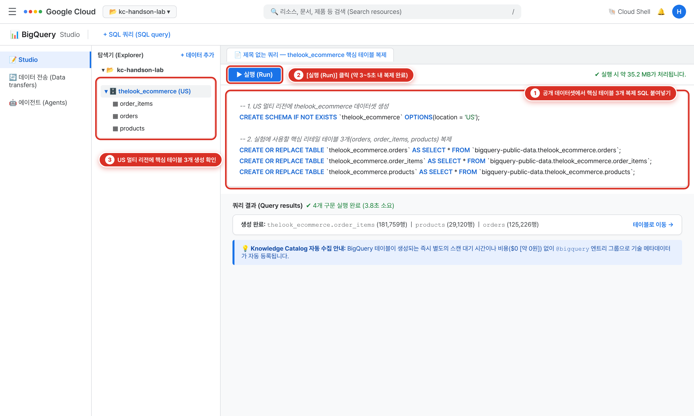
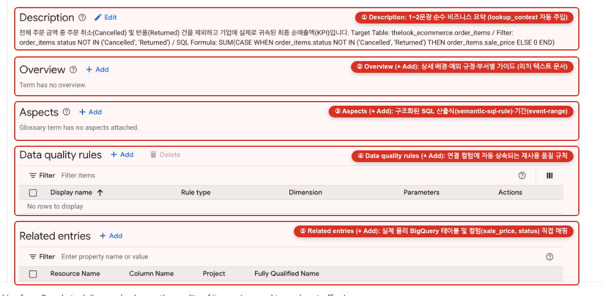
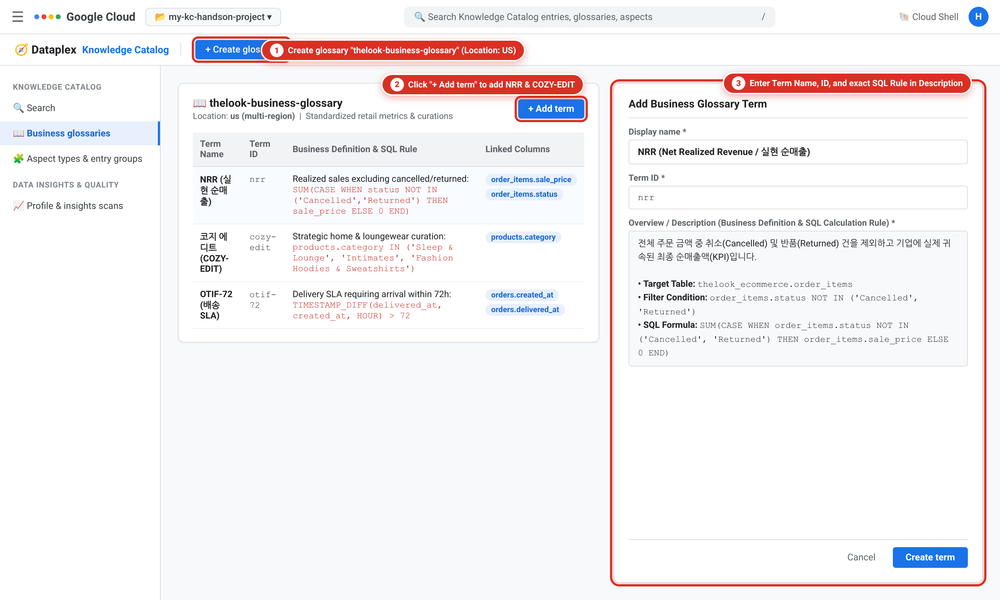
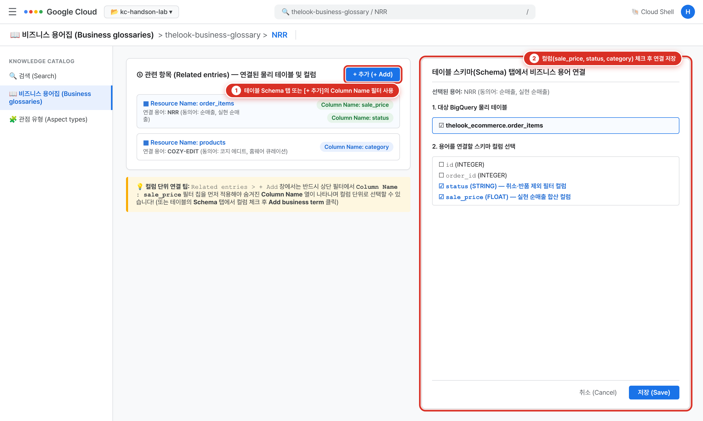
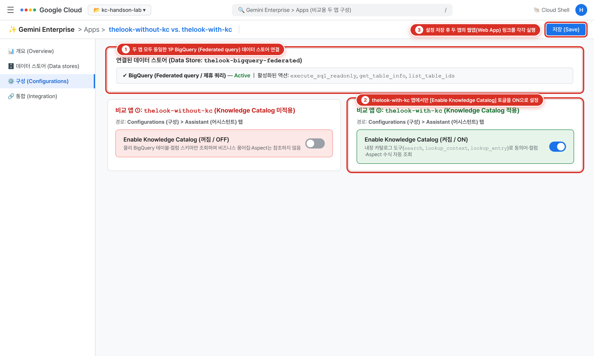
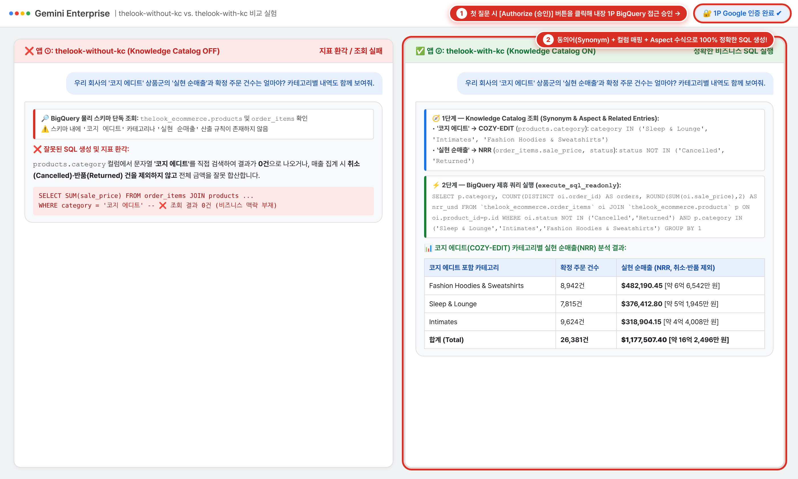

# Gemini Enterprise에서 Knowledge Catalog와 BigQuery 연동하기 (Before vs. After 비교 핸즈온)

> [!NOTE]
> **1차 기본 핸즈온 가이드 (100% 콘솔 실습 · OAuth 수동 발급 불필요 · 두 앱 나란히 비교)**  
> 별도의 초기화 스크립트나 복잡한 OAuth 2.0 클라이언트 발급 없이 **Google Cloud Console 화면만으로** 실습용 이커머스 데이터를 복제하고, **Knowledge Catalog** 핵심 메타데이터(동의어·테이블/컬럼 매핑·Aspect 수식)를 등록한 뒤, **Gemini Enterprise**에 **Knowledge Catalog 미적용 앱(`thelook-without-kc`)**과 **적용 앱(`thelook-with-kc`)** 두 개를 만들어 생성형 AI의 SQL 정확도 차이를 직접 실험하는 가이드입니다.

---

## 실습 개요 (Overview)

기업의 데이터 웨어하우스(BigQuery)에 생성형 AI 에이전트를 연결할 때 가장 흔히 겪는 실패 원인은 **비즈니스 맥락이 없는 물리 스키마(Context-less Raw Schema)**입니다. 데이터베이스의 물리 테이블·컬럼명(`order_items.sale_price`, `order_items.status`, `products.category`)만 보고서는 사내 고유 지표인 **`NRR`(실현 순매출 — 취소·반품 제외)**이나 전략 큐레이션 상품군인 **`COZY-EDIT`(코지 에디트 — 홈·라운지웨어 3개 카테고리 묶음)**의 의미를 알 수 없어 AI 에이전트가 엉뚱한 SQL을 작성하는 **지표 환각(Metric Hallucination)**이 발생합니다.

이 핸즈온에서는 불필요한 설정을 덜어내고, 실제로 AI 에이전트의 SQL 생성에 관여하는 **3가지 핵심 메타데이터 기능**만 압축적으로 구성하여 검증합니다.

1. **Synonyms (동의어 매핑)**: 사용자가 영문 약어(`NRR`, `COZY-EDIT`) 대신 한글 일상 용어(**`실현 순매출`**, **`코지 에디트`**)로 질문해도 표준 비즈니스 용어를 찾아내는지 실험합니다.
2. **Related entries (물리 테이블·컬럼 매핑)**: 비즈니스 용어와 실제 BigQuery 물리 테이블·컬럼(**`order_items.sale_price`**, **`order_items.status`**, **`products.category`**)이 정확히 연결되는지 실험합니다.
3. **Overview & Aspects (비즈니스 필터 및 SQL 산출식 주입)**: 단순 합계가 아닌 취소·반품 제외 수식(`status NOT IN ('Cancelled', 'Returned')`)과 3개 카테고리 필터(`category IN (...)`)가 생성되는 SQL에 자동 반영되는지 실험합니다.

---

## 실습 구성 (What You'll Do)

* **실습 1**: **BigQuery Studio**에서 SQL 쿼리 한 번으로 핵심 이커머스 테이블 3개(`orders`, `order_items`, `products`)를 내 프로젝트로 복제합니다.
* **실습 2**: **Knowledge Catalog**에서 용어집(Business Glossary)을 만들고, 실험에 꼭 필요한 **2개의 핵심 용어(`NRR`, `COZY-EDIT`)**에 대해 **Description · Overview · Aspects · Related entries · Synonyms**를 구성합니다.
* **실습 3**: **Gemini Enterprise**에서 내장 **BigQuery (`Federated query`)** 데이터 스토어를 연결하고, 비교 실험을 위해 **두 개의 앱**을 만듭니다.
  * **앱 ① `thelook-without-kc`**: Knowledge Catalog 비활성화 (`Enable Knowledge Catalog` **OFF**)
  * **앱 ② `thelook-with-kc`**: Knowledge Catalog 활성화 (`Enable Knowledge Catalog` **ON**)
* **실습 4**: 두 앱에 동일한 자연어 질문을 던져 **Synonym · 테이블/컬럼 매핑 · Aspect 수식**이 실제 쿼리 결과에 미치는 차이를 나란히 검증합니다.

---

## 실습 1. BigQuery Studio에서 실습용 이커머스 테이블 복제하기

외부 데이터를 다운로드하거나 업로드할 필요 없이, 구글 클라우드가 기본 제공하는 공개 데이터셋(`bigquery-public-data.thelook_ecommerce`)에서 이번 실험에 사용할 핵심 테이블만 내 프로젝트로 즉시 복제합니다.

### BigQuery Studio에서 테이블 복제 SQL 실행하기

1. Google Cloud 콘솔 좌측 상단 **탐색 메뉴(☰)**에서 **BigQuery** > **Studio**를 클릭합니다.
2. 편집기 상단 탭 바에서 **+** (**SQL query**) 버튼을 클릭해 새 쿼리 창을 엽니다.
3. 아래 SQL 쿼리를 복사해 붙여넣고 **Run(실행)** 버튼을 클릭합니다.

```sql
-- 1. US 멀티 리전에 thelook_ecommerce 데이터셋 생성
CREATE SCHEMA IF NOT EXISTS `thelook_ecommerce`
OPTIONS(location = 'US');

-- 2. 실험에 사용할 핵심 리테일 테이블 3개(orders, order_items, products) 복제
CREATE OR REPLACE TABLE `thelook_ecommerce.orders` AS
SELECT * FROM `bigquery-public-data.thelook_ecommerce.orders`;

CREATE OR REPLACE TABLE `thelook_ecommerce.order_items` AS
SELECT * FROM `bigquery-public-data.thelook_ecommerce.order_items`;

CREATE OR REPLACE TABLE `thelook_ecommerce.products` AS
SELECT * FROM `bigquery-public-data.thelook_ecommerce.products`;
```

4. 약 3~5초 후 쿼리가 완료되면 좌측 **Explorer(탐색기)** 패널에 `thelook_ecommerce` 데이터셋과 3개의 테이블(`orders`, `order_items`, `products`)이 생성된 것을 확인합니다.



> [!TIP]
> **Knowledge Catalog 자동 수집:** BigQuery에 테이블이 생성되는 즉시 **Knowledge Catalog**가 별도의 대기 시간이나 스캔 비용(`$0 [약 0원]`) 없이 테이블과 컬럼 기술 메타데이터를 `@bigquery` 엔트리 그룹으로 자동 수집합니다.

---

## 실습 2. Knowledge Catalog에 비즈니스 용어집 및 핵심 메타데이터 등록하기

이제 물리 테이블 위에 비즈니스 맥락을 입힐 차례입니다. 먼저 Knowledge Catalog 용어(Term) 상세 화면의 **5가지 섹션**이 각각 어떤 역할을 하는지 살펴본 뒤, 이번 실험에서 실제로 테스트할 **2개의 핵심 용어(`NRR`, `COZY-EDIT`)**만 간결하게 등록합니다.

### Knowledge Catalog 용어(Term) 상세 화면의 5가지 영역 이해하기

**Dataplex > Business glossaries**에서 개별 용어(Term)를 클릭하면 화면이 아래 **5가지 영역(①~⑤)**과 우측 **Synonyms(동의어)** 패널로 나뉩니다.



| 화면 영역 | 핵심 역할 | Gemini Enterprise 에이전트가 활용하는 방식 | 이번 핸즈온 실습 범위 |
| :--- | :--- | :--- | :--- |
| **① Description** (`✏️ Edit`) | **1~2문장 핵심 요약 정의** (검색 결과 카드 및 컬럼 툴팁에 노출) | 컬럼에 용어가 연결되어 있으면 에이전트가 테이블 맥락(`lookup_context`)을 조회할 때 컬럼 스키마 옆에 **1차로 자동 주입**됩니다. | **필수 입력** (간결한 1~2문장 비즈니스 정의) |
| **② Overview** (`+ Add`) | **상세 비즈니스 배경 및 포함/제외 규칙** (리치 텍스트 문서) | 시스템 Aspect(`overview`)에 저장되며, `lookup_context` 및 `lookup_entry` 호출 시 **어떤 상태값이나 카테고리를 포함·제외해야 하는지** 상세 지침을 전달합니다. | **필수 입력** (취소·반품 제외 기준, 3대 카테고리 포함 기준) |
| **③ Aspects** (`+ Add`) | **구조화된 커스텀 메타데이터 (Key-Value)** | 사용자가 정의한 Aspect Type 템플릿(`semantic-sql-rule`)에 따라 **SQL 산출 수식(`sql_expression`), 대상 테이블(`target_tables`), 필터 조건**을 정형 필드로 저장하며, 에이전트가 `lookup_entry` 호출 시 읽어갑니다. | **필수 입력** (`semantic-sql-rule` 수식 연결) |
| **④ Data quality rules** (`+ Add`) | **용어 기반 데이터 품질 검증 규칙** (`Range check`, `Set check` 등) | 이 용어가 연결된 BigQuery 컬럼에 대해 Dataplex 자동 데이터 품질 스캔(Auto DQ)을 실행할 때 검증 규칙을 일괄 상속합니다. | **생략 가능** *(AI SQL 생성 실험이 목적이므로 본 실습에서는 건너뜁니다)* |
| **⑤ Related entries** (`+ Add`) | **물리 테이블 및 컬럼 매핑** (시맨틱 연결고리) | 비즈니스 용어(`@dataplex`)와 실제 BigQuery 물리 테이블·컬럼(`@bigquery`의 `order_items.sale_price`, `products.category`)을 양방향으로 연결합니다. | **필수 입력** (테이블 및 컬럼 연결 실험) |
| **우측 패널: Synonyms** (`+ Add`) | **동의어 및 현업 은어 별칭** | 사용자가 영문 코드(`NRR`) 대신 한글 동의어(**`순매출`**, **`코지 에디트`**)로 질문했을 때 `search` 도구가 해당 용어를 찾아내도록 연결합니다. | **필수 입력** (한글 동의어 검색 실험) |

---

### Step 2-1. `③ Aspects`에 부착할 SQL 규칙 템플릿(`semantic-sql-rule`) 생성하기

용어의 **③ Aspects** 영역에 SQL 산출 수식과 필터 조건을 구조화해 넣으려면 먼저 Aspect Type(메타데이터 템플릿)을 하나 만들어 두어야 합니다.

1. Google Cloud 콘솔에서 **Dataplex** > **Catalog** (또는 좌측 메뉴 **Manage** > **Aspect types**)로 이동한 뒤 **Create aspect type**을 클릭합니다.
2. 기본 정보를 다음과 같이 입력합니다.
   - **Display name**: `Semantic Metric & SQL Calculation Rule`
   - **Aspect type ID**: `semantic-sql-rule`
   - **Location**: `us (multi-region)`
3. 아래 **3개의 핵심 텍스트(String / Text) 필드**만 간단히 추가하고 **Create**를 클릭합니다. *(입력할 필드를 최소화해 빠르게 생성합니다)*
   - `sql_expression` *(표준 GoogleSQL 집계 수식 또는 조건식)*
   - `target_tables` *(조회할 대상 BigQuery 테이블명)*
   - `filter_or_join_rule` *(필수 WHERE 조건 또는 JOIN 키)*

---

### Step 2-2. 비즈니스 용어집(Business Glossary) 생성하기

1. 좌측 메뉴에서 **Dataplex** > **Business glossaries**로 이동한 뒤 **Create business glossary**를 클릭합니다.
2. 아래 표와 같이 입력하고 **Create**를 클릭합니다.

| 항목 (Property) | 입력값 (Value) |
| :--- | :--- |
| **Display name** | **TheLook 전사 공통 용어집** |
| **Glossary ID** | **thelook-business-glossary** |
| **Location** | **us (multi-region)** |
| **Description** | **전사 공통 매출 지표(NRR) 및 전략 큐레이션 상품군(COZY-EDIT) 표준 용어집입니다.** |



---

### Step 2-3. 핵심 용어 2개(`NRR`, `COZY-EDIT`) 추가 및 메타데이터 연결하기

생성된 **TheLook 전사 공통 용어집**(`thelook-business-glossary`) 안으로 들어가 **+ Add term**을 클릭하여 아래 **2개의 용어**만 등록합니다.

> [!IMPORTANT]
> **💡 `⑤ Related entries`에서 테이블이 아닌 '특정 컬럼(Column)'을 연결하는 방법 (콘솔 UI 주의사항)**
> 용어 상세 화면의 **`⑤ Related entries` > `+ Add`** 창은 기본 상태에서 테이블 목록만 보여주고 `Column Name` 열을 숨겨둡니다. 따라서 아무 필터 없이 테이블 체크박스를 선택하면 `Column Name: -` (테이블 단위 연결)로만 등록됩니다. **특정 컬럼(`sale_price`, `category` 등)까지 정확히 연결하려면 아래 두 가지 방법 중 하나를 사용하세요.**
>
> 1. **방법 A (가장 직관적 — 테이블 `Schema` 탭에서 연결하기, 권장):**
>    - 좌측 메뉴 **Dataplex > Search**에서 테이블 이름(`order_items` 또는 `products`)을 검색해 클릭합니다.
>    - 테이블 상세 화면의 **`Schema`** 탭으로 이동한 뒤, 연결할 컬럼(**`sale_price`**, **`status`** 등) 좌측 체크박스를 선택하고 상단의 **`Add business term`** 버튼을 눌러 용어(`NRR`)를 선택합니다.
> 2. **방법 B (`⑤ Related entries > + Add` 창 안에서 필터 칩으로 연결하기):**
>    - `+ Add` 창 상단의 **Filter** 입력란을 클릭하고 드롭다운에서 반드시 **`Column Name`**을 선택한 뒤 컬럼명(예: **`Column Name : sale_price`**)을 입력합니다.
>    - 필터 칩이 생성되는 즉시 숨겨져 있던 **`Column Name`** 열이 화면에 나타나며, 이때 표시되는 컬럼 행을 체크하고 **Add**를 클릭합니다. *(주의: 필터 칩을 넣기 전에 미리 체크해 둔 테이블 행이 있으면 체크를 해제하세요.)*

---

#### 📌 용어 1: `NRR` (동의어 + 취소·반품 제외 Aspect 수식 + `order_items` 컬럼 매핑 실험용)

- **Display name**: `NRR`
- **Term ID**: `nrr`

| 용어 상세 화면 영역 | 조작 방법 | 입력할 내용 |
| :--- | :--- | :--- |
| **① Description** | `✏️ Edit` 클릭 | `전체 주문 금액 중 주문 취소(Cancelled) 및 반품(Returned) 건을 제외하고 기업에 실제로 귀속된 최종 실현 순매출액(Net Realized Revenue)입니다.` |
| **② Overview** | `+ Add` 클릭 | **• 산출 목적**: 단순 판매가 합계(총거래액 GMV) 착시를 방지하고 취소·반품을 차감한 실질 귀속 매출 산출<br>**• 포함/제외 기준**: `Complete`, `Shipped`, `Processing` 상태는 포함하며, **`Cancelled`(주문 취소) 및 `Returned`(반품 완료) 상태는 반드시 제외**<br>**• 기준 컬럼**: `thelook_ecommerce.order_items` 테이블의 `sale_price`(판매 단가) 및 `status`(주문 상태) |
| **③ Aspects** | `+ Add` 클릭 후 **`Semantic Metric & SQL Calculation Rule`** 선택 | • **sql_expression**: `SUM(CASE WHEN order_items.status NOT IN ('Cancelled', 'Returned') THEN order_items.sale_price ELSE 0 END)`<br>• **target_tables**: `thelook_ecommerce.order_items`<br>• **filter_or_join_rule**: `order_items.status NOT IN ('Cancelled', 'Returned')` |
| **⑤ Related entries** | 테이블 `Schema` 탭 또는 `+ Add` (`Column Name` 필터) | **`order_items`** 테이블의 **`sale_price`**, **`status`** 컬럼 연결 *(테이블 단위로 `order_items`를 함께 연결해도 무방합니다)* |
| **우측 패널: Synonyms** | `+ Add` 클릭 | `순매출`, `실현 순매출`, `실현매출`, `Net Realized Revenue` |

---

#### 📌 용어 2: `COZY-EDIT` (동의어 + 3개 카테고리 필터 Aspect/Overview + `products` 컬럼 매핑 실험용)

- **Display name**: `COZY-EDIT`
- **Term ID**: `cozy-edit`

| 용어 상세 화면 영역 | 조작 방법 | 입력할 내용 |
| :--- | :--- | :--- |
| **① Description** | `✏️ Edit` 클릭 | `사내 MD와 마케터가 홈웨어, 잠옷, 이너웨어 및 후드/스웻셔츠 등 실내외 이지웨어 주력 상품군 3종을 하나로 묶어 부르는 사내 전략 큐레이션 용어입니다.` |
| **② Overview** | `+ Add` 클릭 | **• 포함 물리 카테고리 (3종)**: `products.category` 컬럼 값이 **`'Sleep & Lounge'`**, **`'Intimates'`**, **`'Fashion Hoodies & Sweatshirts'`**인 상품만 포함<br>**• 제외 주의사항**: `'Active'`(스포츠웨어)나 `'Socks & Hosiery'`는 코지 에디트에서 제외함 (물리 DB에는 `'COZY-EDIT'`이라는 카테고리 문자열이 존재하지 않음) |
| **③ Aspects** | `+ Add` 클릭 후 **`Semantic Metric & SQL Calculation Rule`** 선택 | • **sql_expression**: `products.category IN ('Sleep & Lounge', 'Intimates', 'Fashion Hoodies & Sweatshirts')`<br>• **target_tables**: `thelook_ecommerce.products`<br>• **filter_or_join_rule**: `order_items.product_id = products.id` |
| **⑤ Related entries** | 테이블 `Schema` 탭 또는 `+ Add` (`Column Name` 필터) | **`products`** 테이블의 **`category`** 컬럼 연결 |
| **우측 패널: Synonyms** | `+ Add` 클릭 | `코지 에디트`, `코지에디트`, `홈웨어 큐레이션` |



---

## 실습 3. Gemini Enterprise에서 BigQuery 연결 및 두 가지 비교 앱(`Without KC` vs. `With KC`) 만들기

이제 **Gemini Enterprise**에서 BigQuery 데이터 스토어를 연결하고, **Knowledge Catalog 연동 여부만 다른 두 개의 앱**을 만들어 실제 동작 차이를 투명하게 비교할 준비를 합니다.

> [!TIP]
> **별도의 OAuth 2.0 Client ID 발급이 필요 없는 이유:**  
> Gemini Enterprise의 기본 제공(First-party) **BigQuery (`Federated query`)** 커넥터와 **Enable Knowledge Catalog** 기능은 구글 내부 **1P Offline OAuth** 인증을 자동으로 처리합니다. 따라서 `APIs & Services > Credentials`에서 OAuth 클라이언트를 수동으로 만들거나 Argolis 조직 정책을 변경할 필요가 전혀 없습니다.

### Step 3-1. BigQuery (`Federated query`) 데이터 스토어 생성 및 액션 활성화

1. Google Cloud 콘솔에서 **Gemini Enterprise** > **Data stores**로 이동한 뒤 **+ Create data store**를 클릭합니다.
2. **First-party data sources (Google Cloud)** 목록에서 **BigQuery**를 선택합니다.
3. 연결 방식(Connection mode)으로 **Federated query (recommended)**를 선택합니다.
4. 커넥터 설정을 다음과 같이 입력하고 **Create**를 클릭합니다.
   - **Data connector name**: `thelook-bigquery-federated`
   - **Billing Project ID**: 현재 실습 중인 본인의 Google Cloud 프로젝트 ID 입력 *(예: `kc-handson-lab-01` — 쿼리 실행 시 슬롯/스캔 과금이 부과될 프로젝트)*
5. 생성된 **`thelook-bigquery-federated`** 데이터 스토어를 클릭해 상세 화면으로 들어간 뒤, **Actions** 탭을 열어 아래 분석 도구 액션들이 활성화되어 있는지 확인(또는 체크 후 활성화)합니다.
   - **`Execute SQL (Read-Only)`** (`execute_sql_readonly`)
   - **`Get Table Info`** (`get_table_info`) 및 **`Get Dataset Info`** (`get_dataset_info`)
   - **`List Dataset IDs`** (`list_dataset_ids`) 및 **`List Table IDs`** (`list_table_ids`)
   - **`Get Query Results`** (`get_query_results`) 및 **`Get Job`** (`get_job`)

---

### Step 3-2. 비교 앱 ① 생성: Knowledge Catalog 미적용 앱 (`thelook-without-kc`)

먼저 물리 BigQuery 스키마만 바라보고 Knowledge Catalog는 참조하지 않는 대조군(Before) 앱을 만듭니다.

1. **Gemini Enterprise** 좌측 메뉴에서 **Apps**를 클릭하고 **+ Create app**을 클릭합니다.
2. 아래와 같이 설정하고 **Create**를 클릭합니다.
   - **App name**: **`thelook-without-kc`**
   - **Location**: **`global (Global)`**
   - **Data stores**: 방금 만든 **`thelook-bigquery-federated`** 선택 및 연결
3. 생성된 **`thelook-without-kc`** 앱의 좌측 메뉴에서 **Configurations** > **Assistant** 탭을 확인합니다.
   - **Enable Knowledge Catalog** 토글이 **꺼진 상태(Off, 기본값)**인지 확인합니다. *(이 앱은 오직 BigQuery 물리 테이블·컬럼 스키마만 볼 수 있습니다.)*

---

### Step 3-3. 비교 앱 ② 생성: Knowledge Catalog 적용 앱 (`thelook-with-kc`)

이번에는 동일한 BigQuery 데이터 스토어를 바라보면서 **Knowledge Catalog 연동만 켠** 실험군(After) 앱을 만듭니다.

1. 다시 **Gemini Enterprise** > **Apps**로 이동해 **+ Create app**을 클릭합니다.
2. 아래와 같이 설정하고 **Create**를 클릭합니다.
   - **App name**: **`thelook-with-kc`**
   - **Location**: **`global (Global)`**
   - **Data stores**: 동일한 **`thelook-bigquery-federated`** 데이터 스토어 선택 및 연결
3. 생성된 **`thelook-with-kc`** 앱의 좌측 메뉴에서 **Configurations** > **Assistant** 탭으로 이동합니다.
4. 화면 아래쪽의 **Enable Knowledge Catalog** 토글을 **켬(On)**으로 변경하고 **Save**(또는 **Save and publish**)를 클릭합니다.
   - *(이 토글을 켜면 에이전트에 내장 Knowledge Catalog 도구인 `knowledge_catalog_search`, `knowledge_catalog_lookup_context`, `knowledge_catalog_lookup_entry`가 자동으로 장착됩니다.)*



---

## 실습 4. 두 앱(`thelook-without-kc` vs. `thelook-with-kc`) 나란히 비교 실험하기

각 앱의 **Integration**(또는 **Overview**) 탭에 있는 **Web App URL** 링크를 클릭하여 브라우저 탭 두 개에 **`thelook-without-kc`** 웹앱과 **`thelook-with-kc`** 웹앱을 나란히 띄웁니다.  
*(첫 질문 실행 시 BigQuery 권한 승인 안내 배너가 나타나면 **Authorize**를 눌러 본인 계정으로 승인합니다.)*

우리가 실습 2에서 구성한 **① Synonym(동의어)**, **② Related entries(테이블·컬럼 매핑)**, **③ Aspects/Overview(SQL 수식 및 필터)** 3가지가 실제로 작동하는지 아래 **3가지 테스트 케이스**로 직접 확인해 보세요.

---

### 🧪 테스트 케이스 1: [Synonym + Aspect 수식 실험] 한글 동의어(`실현 순매출`) 질문 시 취소·반품 제외 수식이 적용되는가?

영문 용어명(`NRR`)이나 취소·반품 제외 조건을 프롬프트에 전혀 적지 않고, 우리가 등록한 한글 **Synonym(`실현 순매출`)**만으로 질문해 봅니다.

> **💬 입력 프롬프트 (두 앱에 동일하게 입력):**
> ```text
> 우리 쇼핑몰의 전체 '실현 순매출' 합계와 해당 주문 상품 건수를 알려줘. 실행한 SQL 쿼리 조건도 함께 설명해 줘.
> ```

| 비교 항목 | ❌ `thelook-without-kc` (Knowledge Catalog 미적용) | ✅ `thelook-with-kc` (Knowledge Catalog 적용) |
| :--- | :--- | :--- |
| **동의어(`실현 순매출`) 해석** | 카탈로그 검색 불가 — 일반 상식에 의존해 `order_items.sale_price` 합계로만 추측 | **`Synonyms`(`실현 순매출`)** 검색을 통해 표준 용어 **`NRR`** 엔트리를 정확히 식별 |
| **생성된 SQL 로직 차이** | `status` 필터를 누락하고 취소(`Cancelled`)·반품(`Returned`)까지 합산하거나, 임의로 `'Complete'` 상태만 필터링함 | **`③ Aspects`(`semantic-sql-rule`)** 및 **`② Overview`**에 정의된 **`order_items.status NOT IN ('Cancelled', 'Returned')`** 조건을 정확히 반영 |
| **참조한 물리 컬럼** | 스키마 이름만 보고 추측 | **`⑤ Related entries`**에 연결된 `thelook_ecommerce.order_items`의 **`sale_price`**, **`status`** 컬럼을 근거로 쿼리 작성 |

---

### 🧪 테스트 케이스 2: [테이블·컬럼 매핑 + Overview/Aspect 필터 실험] 사내 용어(`코지 에디트`)가 물리 테이블(`products.category`)의 3개 카테고리로 변환되는가?

물리 DB에는 `'COZY-EDIT'`이나 `'코지 에디트'`라는 문자열이 전혀 없습니다. 한글 동의어인 **`코지 에디트`**로 질문했을 때 물리 테이블 `products`의 `category` 컬럼 3종으로 변환되는지 확인합니다.

> **💬 입력 프롬프트 (두 앱에 동일하게 입력):**
> ```text
> '코지 에디트' 상품군에는 어떤 카테고리가 포함되는지, 각 카테고리별 등록 상품 수(products 테이블 기준)를 조회해 줘.
> ```

| 비교 항목 | ❌ `thelook-without-kc` (Knowledge Catalog 미적용) | ✅ `thelook-with-kc` (Knowledge Catalog 적용) |
| :--- | :--- | :--- |
| **용어 검색 및 테이블 탐색** | `products` 테이블에서 `WHERE category LIKE '%Cozy%'` 또는 `= 'COZY-EDIT'`을 실행 | **`Synonyms`(`코지 에디트`)**로 **`COZY-EDIT`** 용어를 찾고 **`⑤ Related entries`**에 연결된 **`products.category`** 컬럼 확인 |
| **카테고리 필터 변환** | 매칭되는 행이 없어 **`0건 (해당 상품 없음)`** 반환 또는 엉뚱한 카테고리 추측 | **`② Overview` / `③ Aspects`**에 정의된 **`products.category IN ('Sleep & Lounge', 'Intimates', 'Fashion Hoodies & Sweatshirts')`** 3개 카테고리로 변환하여 각 카테고리별 상품 수를 정확히 집계 |

---

### 🧪 테스트 케이스 3: [통합 시나리오] 두 용어(`코지 에디트` + `실현 순매출`) 결합 및 테이블 자동 조인(`products` ⋈ `order_items`) 실험

마지막으로 두 비즈니스 용어를 한 문장에 섞어 질문했을 때, 에이전트가 두 용어의 메타데이터를 모두 조회해 `products`와 `order_items` 테이블을 정확히 조인(`order_items.product_id = products.id`)하는지 확인합니다.

> **💬 입력 프롬프트 (두 앱에 동일하게 입력):**
> ```text
> 우리 회사의 '코지 에디트' 상품군의 '실현 순매출'과 확정 주문 건수는 얼마야? 카테고리별 내역도 함께 보여줘.
> ```

* **`thelook-without-kc` (Before)**: `'코지 에디트'` 카테고리를 찾지 못해 조회 결과가 **`0건`**으로 나오거나, 취소·반품이 포함된 잘못된 매출액을 출력합니다.
* **`thelook-with-kc` (After — Aha! Moment)**:
  1. Knowledge Catalog에서 **`COZY-EDIT`**(`products.category IN ('Sleep & Lounge', 'Intimates', 'Fashion Hoodies & Sweatshirts')`)과 **`NRR`**(`order_items.status NOT IN ('Cancelled', 'Returned')`, `SUM(order_items.sale_price)`) 두 용어의 정의, 연결된 컬럼, Aspect SQL 규칙을 동시에 가져옵니다.
  2. 두 테이블(`thelook_ecommerce.order_items`와 `thelook_ecommerce.products`)을 조인하는 무결점 SQL을 실행하여 3개 카테고리별 매출 내역과 총 실현 순매출(**`$1,177,507.40 [약 16억 2,496만 원]`**, 확정 주문 **26,381건**)을 정확히 반환합니다!


