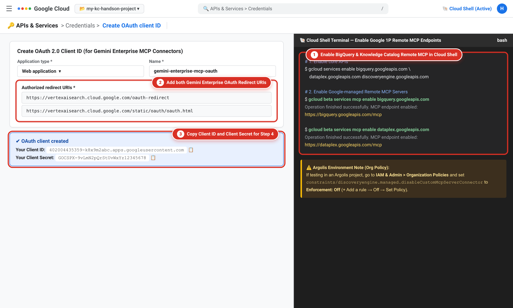
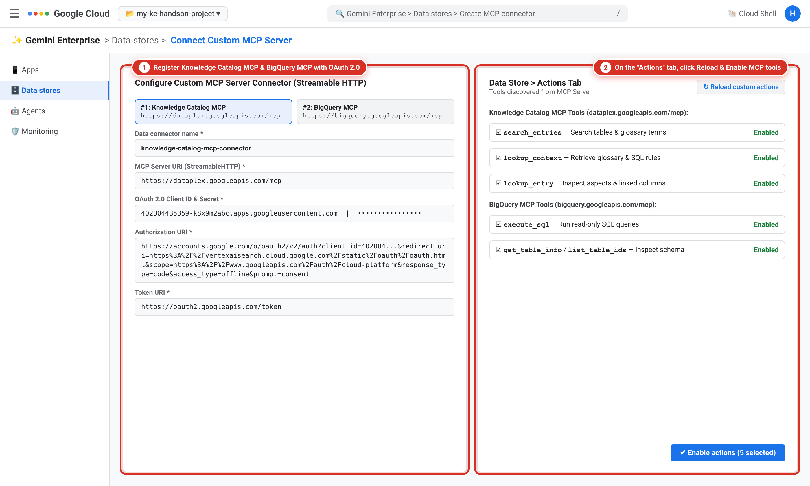

# Configuring Knowledge Catalog and Data Cloud MCP Connectors in Gemini Enterprise

> **1차 기본 핸즈온 가이드 (Zero Asset Initialization · 100% Console-First)**  
> 별도의 GitHub 클론, 스크립트 실행, VM 사전 구축 없이 **Google Cloud Console 화면만으로** 공개 리테일 데이터를 복제하고, **Knowledge Catalog** 비즈니스 용어집 등록부터 **OAuth 2.0 & Remote MCP 커넥터** 연결, **Gemini Enterprise** 자연어 분석(Aha! Moment)까지 30분 만에 완주하는 실습 가이드입니다.

---

## Overview

기업의 데이터 웨어하우스에 생성형 AI 에이전트를 연결할 때 가장 흔히 겪는 실패 원인은 **맥락이 없는 물리 스키마(Context-less Raw Schema)**입니다. 데이터베이스 컬럼명(`sale_price`, `status`, `category`)만으로는 사내 고유 지표인 **`NRR`(실현 순매출 — 취소·반품 제외)**이나 전략 큐레이션 상품군인 **`COZY-EDIT`(코지 에디트 — 홈·라운지웨어 3개 카테고리 묶음)**의 정의를 알 수 없어 AI 에이전트가 엉뚱한 SQL을 작성하는 **지표 환각(Metric Hallucination)**이 발생합니다.

이 핸즈온 실습에서는 **Google Cloud Knowledge Catalog**, **Data Cloud Remote MCP 서버**, 그리고 **Gemini Enterprise**를 사용해 별도의 에이전트 코딩 없이 비즈니스 메타데이터만으로 AI 에이전트의 SQL 정확도를 100%로 끌어올리는 과정을 직접 구현합니다.

---

## What you'll learn

In this lab, you learn how to perform the following tasks:

* Copy the canonical retail dataset into your project in **BigQuery Studio** using a single SQL query.
* Create a **Business Glossary** in **Knowledge Catalog**, register business terms (`NRR`, `COZY-EDIT`, `OTIF-72`), and link them to physical BigQuery columns.
* Enable Google-managed **Remote MCP servers** (`bigquery.googleapis.com/mcp`, `dataplex.googleapis.com/mcp`) and create **OAuth 2.0 Web Client** credentials.
* Register **MCP connectors** in **Gemini Enterprise**, enable custom actions, and turn on the **Knowledge Catalog** assistant integration.
* Verify the **Before vs. After (Aha! Moment)** in the **Gemini Enterprise** web app using end-user OAuth 2.0 passthrough.

---

## Task 1. Copy the retail dataset in BigQuery Studio

In this task, you copy the five core e-commerce tables from the `bigquery-public-data.thelook_ecommerce` public dataset directly into your Google Cloud project without running any external initialization scripts.

### Run the dataset replication query in BigQuery Studio

1. In the Google Cloud console, in the **Navigation menu** (☰), click **BigQuery** > **Studio**.
2. In the SQL editor tab bar, click **+** (**SQL query**) to open a new query tab.
3. Paste the following SQL statements into the query editor:

```sql
-- 1. Create thelook_ecommerce dataset in the US multi-region
CREATE SCHEMA IF NOT EXISTS `thelook_ecommerce`
OPTIONS(location = 'US');

-- 2. Replicate 5 core retail tables directly from bigquery-public-data
CREATE OR REPLACE TABLE `thelook_ecommerce.orders` AS
SELECT * FROM `bigquery-public-data.thelook_ecommerce.orders`;

CREATE OR REPLACE TABLE `thelook_ecommerce.order_items` AS
SELECT * FROM `bigquery-public-data.thelook_ecommerce.order_items`;

CREATE OR REPLACE TABLE `thelook_ecommerce.products` AS
SELECT * FROM `bigquery-public-data.thelook_ecommerce.products`;

CREATE OR REPLACE TABLE `thelook_ecommerce.users` AS
SELECT * FROM `bigquery-public-data.thelook_ecommerce.users`;

CREATE OR REPLACE TABLE `thelook_ecommerce.distribution_centers` AS
SELECT * FROM `bigquery-public-data.thelook_ecommerce.distribution_centers`;
```

4. Click **Run**.
   The query completes in approximately 5 seconds and creates the `thelook_ecommerce` dataset and 5 tables (`orders`, `order_items`, `products`, `users`, `distribution_centers`) in the `US` multi-region.


> [!NOTE]
> **Note:** As soon as the BigQuery tables are created, **Knowledge Catalog** automatically harvests and indexes their technical metadata under the `@bigquery` entry group with zero wait time.

---

## Task 2. Create a Business Glossary and link columns in Knowledge Catalog

In this task, you create a Business Glossary in **Knowledge Catalog**, define core retail business terms (`NRR`, `COZY-EDIT`, `OTIF-72`) along with their standard SQL calculation rules, and link each term to the corresponding BigQuery table columns.

### Create a Business Glossary

1. In the Google Cloud console, in the **Navigation menu** (☰), click **Dataplex** > **Business glossaries** (under **Knowledge Catalog**).
2. Click **Create glossary**.
3. On the **Create glossary** page, specify the following, and leave the remaining settings as their defaults:

| Property | Value (type or select) |
| :--- | :--- |
| **Display name** | **TheLook 전사 공통 용어집** |
| **Glossary ID** | **thelook-business-glossary** |
| **Location** | **us (multi-region)** |
| **Description** | **전사 공통 사내 큐레이션 용어(COZY-EDIT), 핵심 매출 지표(NRR), 물류 배송 SLA(OTIF-72) 표준 정의 및 SQL 산출 규칙** |

4. Click **Create**.

### Add business terms (`NRR`, `COZY-EDIT`, `OTIF-72`)

1. In the **Business glossaries** list, click **TheLook 전사 공통 용어집** (`thelook-business-glossary`).
2. Click **Add term**, specify the following for the first term (**`NRR`**), and then click **Create**:

| Property | Value (type or select) |
| :--- | :--- |
| **Display name** | **NRR (Net Realized Revenue / 실현 순매출)** |
| **Term ID** | **nrr** |
| **Description / Overview** | **전체 주문 금액 중 주문 취소(Cancelled) 및 반품(Returned) 건을 제외하고 기업에 실제로 귀속된 최종 순매출액(KPI)입니다. Target Table: `thelook_ecommerce.order_items` / Filter: `order_items.status NOT IN ('Cancelled', 'Returned')` / SQL Formula: `SUM(CASE WHEN order_items.status NOT IN ('Cancelled', 'Returned') THEN order_items.sale_price ELSE 0 END)`** |

3. Click **Add term**, specify the following for the second term (**`COZY-EDIT`**), and then click **Create**:

| Property | Value (type or select) |
| :--- | :--- |
| **Display name** | **코지 에디트 (COZY-EDIT / 홈·라운지웨어 전략 큐레이션군)** |
| **Term ID** | **cozy-edit** |
| **Description / Overview** | **사내 MD·마케터가 홈웨어, 잠옷, 이너웨어 및 스웻셔츠 등 실내외 이지웨어 주력 상품군을 하나로 묶어 부르는 사내 큐레이션 브랜드 용어입니다. Target Table: `thelook_ecommerce.products` / Join: `order_items.product_id = products.id` / SQL Filter: `products.category IN ('Sleep & Lounge', 'Intimates', 'Fashion Hoodies & Sweatshirts')`** |

4. Click **Add term**, specify the following for the third term (**`OTIF-72`**), and then click **Create**:

| Property | Value (type or select) |
| :--- | :--- |
| **Display name** | **OTIF-72 (72시간 정시 배송 SLA 기준)** |
| **Term ID** | **otif-72** |
| **Description / Overview** | **주문 접수(created_at)부터 배송 완료(delivered_at)까지 72시간 이내에 도착해야 함을 규정하는 물류 SLA 기준입니다. Target Table: `thelook_ecommerce.orders` / SQL Condition: `orders.status = 'Complete' AND TIMESTAMP_DIFF(orders.delivered_at, orders.created_at, HOUR) > 72`** |


### Link glossary terms to BigQuery table columns

1. Inside `thelook-business-glossary`, click the **NRR (Net Realized Revenue / 실현 순매출)** term.
2. Select the **Linked assets** tab, and then click **Link asset / column** (or **Add link**).
3. Search for and select the **`thelook_ecommerce.order_items`** BigQuery table entry, select the **`sale_price`** and **`status`** columns, and then click **Save**.
4. Return to the glossary term list, click **코지 에디트 (COZY-EDIT)**, open the **Linked assets** tab, and link it to the **`category`** column of the **`thelook_ecommerce.products`** table.
5. Repeat the process for **OTIF-72** to link it to the **`created_at`** and **`delivered_at`** columns of the **`thelook_ecommerce.orders`** table.


---

## Task 3. Configure OAuth 2.0 credentials and enable remote MCP servers

In this task, you enable the Google-managed Remote MCP servers for BigQuery and Knowledge Catalog and create an OAuth 2.0 Web Client ID so that Gemini Enterprise can query data using end-user credentials.

### Enable the Google-managed Remote MCP servers

1. On the Google Cloud console title bar, click **Activate Cloud Shell** (`>_`).
2. In the Cloud Shell terminal, run the following commands to enable the core APIs and the Google-managed Remote MCP endpoints:

```bash
# 1. Enable BigQuery, Dataplex (Knowledge Catalog), and Discovery Engine (Gemini Enterprise) APIs
gcloud services enable bigquery.googleapis.com \
  dataplex.googleapis.com \
  discoveryengine.googleapis.com

# 2. Enable Google-managed Remote MCP servers
gcloud beta services mcp enable bigquery.googleapis.com
gcloud beta services mcp enable dataplex.googleapis.com
```

> [!WARNING]
> **Warning (Argolis Environments Only):** If you are running this hands-on lab in an **Argolis** project, the organization policy `constraints/discoveryengine.managed.disableCustomMcpServerConnector` (*Disable custom MCP server connector for Gemini Enterprise*) is enforced by default.
> 1. In the Google Cloud console, go to **IAM & Admin** > **Organization Policies**.
> 2. Search for **`constraints/discoveryengine.managed.disableCustomMcpServerConnector`** and click **Manage policy**.
> 3. Select **Override parent's policy**, click **+ Add a rule**, set **Enforcement** to **Off**, click **Done**, and then click **Set policy**.

### Create an OAuth 2.0 Client ID for Gemini Enterprise

1. In the Google Cloud console, in the **Navigation menu** (☰), click **APIs & Services** > **Credentials**.
   *(If prompted to configure the OAuth consent screen first, click **Configure consent screen**, select **Internal**, enter **Gemini Enterprise MCP** as the App name, select your support email, and click **Save and continue**.)*
2. At the top of the **Credentials** page, click **+ Create credentials** > **OAuth client ID**.
3. On the **Create OAuth client ID** page, specify the following:

| Property | Value (type or select) |
| :--- | :--- |
| **Application type** | **Web application** |
| **Name** | **gemini-enterprise-mcp-oauth** |
| **Authorized redirect URIs (URI 1)** | **https://vertexaisearch.cloud.google.com/oauth-redirect** |
| **Authorized redirect URIs (URI 2)** | **https://vertexaisearch.cloud.google.com/static/oauth/oauth.html** |

4. Click **Create**.
5. In the **OAuth client created** dialog, copy **Your Client ID** and **Your Client Secret** to a notepad for use in Task 4.



---

## Task 4. Register MCP connectors and create the Gemini Enterprise app

In this task, you connect **Knowledge Catalog** and **BigQuery** to **Gemini Enterprise** using the MCP endpoints and OAuth 2.0 credentials, enable the MCP tool actions, and publish a Gemini Enterprise assistant app.

> [!TIP]
> **Two Supported Connection Paths in Gemini Enterprise:**
> - **Path A (Custom Remote MCP Connectors — Explicit Tool Control):** Register `https://dataplex.googleapis.com/mcp` and `https://bigquery.googleapis.com/mcp` directly with your OAuth 2.0 Client ID and Secret so you can inspect and toggle individual MCP tools (`search_entries`, `lookup_context`, `execute_sql`).
> - **Path B (First-Party BigQuery Federated Query Connector):** Select **First-party data sources** > **BigQuery** > **Federated query (recommended)**, which uses `bigquery_mcp` under the hood and automatically turns on **Enable Knowledge Catalog** on the app's **Assistant** tab.

### Register the Knowledge Catalog & BigQuery MCP connectors

1. In the Google Cloud console, go to **Gemini Enterprise** > **Data stores**, and then click **Create data store**.
2. Select **Custom MCP server** (or **BigQuery** > **Federated query**), and specify the following to register the **Knowledge Catalog MCP** connector:

| Property | Value (type or select) |
| :--- | :--- |
| **Data connector name** | **knowledge-catalog-mcp-connector** |
| **MCP Server URI (StreamableHTTP)** | **https://dataplex.googleapis.com/mcp** |
| **Client ID** | *`[Your OAuth 2.0 Client ID from Task 3]`* |
| **Client Secret** | *`[Your OAuth 2.0 Client Secret from Task 3]`* |
| **Authorization URI** | `https://accounts.google.com/o/oauth2/v2/auth?client_id=YOUR_CLIENT_ID&redirect_uri=https%3A%2F%2Fvertexaisearch.cloud.google.com%2Fstatic%2Foauth%2Foauth.html&scope=https%3A%2F%2Fwww.googleapis.com%2Fauth%2Fcloud-platform&include_granted_scopes=true&response_type=code&access_type=offline&prompt=consent` |
| **Token URI** | **https://oauth2.googleapis.com/token** |

3. Repeat the steps to create the **BigQuery MCP** connector (`bigquery-mcp-connector`) using the endpoint **`https://bigquery.googleapis.com/mcp`** (and scope `https://www.googleapis.com/auth/bigquery` or `cloud-platform`).
4. Open each created data store, select the **Actions** tab, click **Reload custom actions**, select all discovered MCP tools (`search_entries`, `lookup_context`, `lookup_entry`, `execute_sql`, `get_table_info`), and click **Enable actions**.



### Create the Gemini Enterprise app and enable Knowledge Catalog

1. In the **Gemini Enterprise** navigation menu, click **Apps**, and then click **Create app**.
2. For **App name**, type **thelook-kc-assistant**, select the **global (Global)** multi-region, attach your data stores/connectors, and click **Create**.
3. Inside the **thelook-kc-assistant** app, click **Configurations** in the left navigation pane, and then select the **Assistant** tab.
4. In the **Enable Knowledge Catalog** section, verify that the toggle is turned **On**, and then click **Save and publish**.


---

## Task 5. Test Before vs. After in the Gemini Enterprise web app

In this final task, you launch the **Gemini Enterprise** web app, authorize your OAuth 2.0 session, and compare the response quality with and without **Knowledge Catalog** grounding.

### Compare Before (Without Knowledge Catalog) vs. After (With Knowledge Catalog)

1. In the **Gemini Enterprise** console, go to **Apps** > **thelook-kc-assistant** > **Integration** (or **Overview**), and click the published **Web App URL** link to open the chat interface.
2. Enter the following natural-language business question in the prompt bar:

   **우리 회사의 '코지 에디트(COZY-EDIT)' 상품군의 실현 순매출(NRR)과 확정 주문 건수는 얼마야? 카테고리별 내역도 함께 보여줘**

3. When prompted by the connector authorization banner, click **Authorize** and approve the Google OAuth 2.0 consent popup using your logged-in account.
4. Observe the **Aha! Moment** in the agent's reasoning trace and final answer:
   - **Without Knowledge Catalog (Before):** The agent inspects raw BigQuery table schemas (`products`, `order_items`), fails to find any column or category value literally named `'COZY-EDIT'` or `'NRR'`, and either returns `0 rows` or erroneously sums `sale_price` across cancelled and returned orders.
   - **With Knowledge Catalog + MCP (After):**
     1. The agent calls Knowledge Catalog (`search_entries` and `lookup_context`) to retrieve the exact business definitions and linked columns for **`COZY-EDIT`** (`products.category IN ('Sleep & Lounge', 'Intimates', 'Fashion Hoodies & Sweatshirts')`) and **`NRR`** (`SUM(sale_price)` where `order_items.status NOT IN ('Cancelled', 'Returned')`).
     2. The agent passes this grounded context to the BigQuery MCP connector (`execute_sql`) and runs a verified read-only SQL query to return the exact category breakdown and total NRR (**`$1,177,507.40 [약 16억 2,496만 원]`** across **26,381** realized orders).


### Try an additional SLA breach prompt (`OTIF-72`)

To verify that your third glossary term (**`OTIF-72`**) also grounds SQL generation automatically, enter the following follow-up prompt:

**우리 물류 기준인 OTIF-72를 위반한 지연 주문은 총 몇 건이고, 지연된 주문의 실현 순매출(NRR) 합계는 얼마야?**

The agent automatically looks up **`OTIF-72`** (`TIMESTAMP_DIFF(orders.delivered_at, orders.created_at, HOUR) > 72` and `orders.status = 'Complete'`) in **Knowledge Catalog** and joins `orders` with `order_items` in **BigQuery** to calculate the exact SLA breach metrics without any manual SQL hinting.
